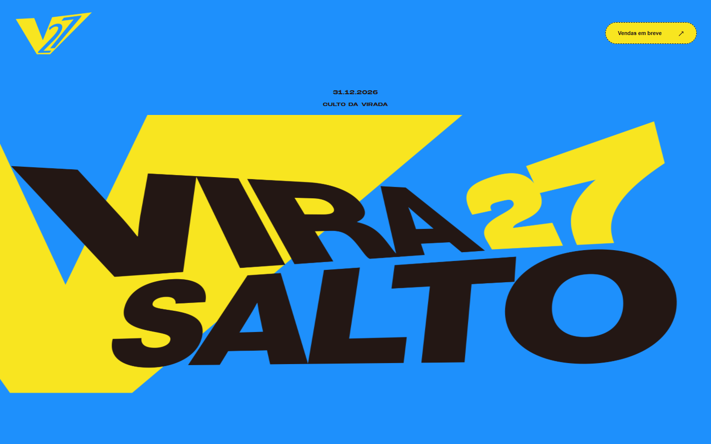
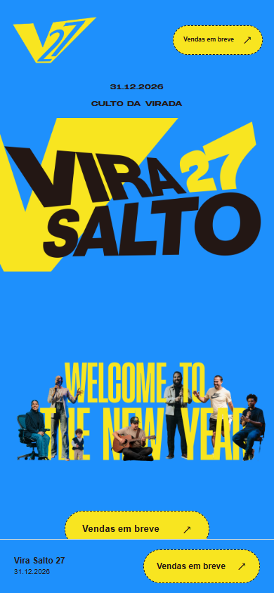
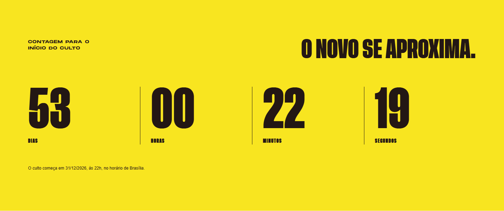
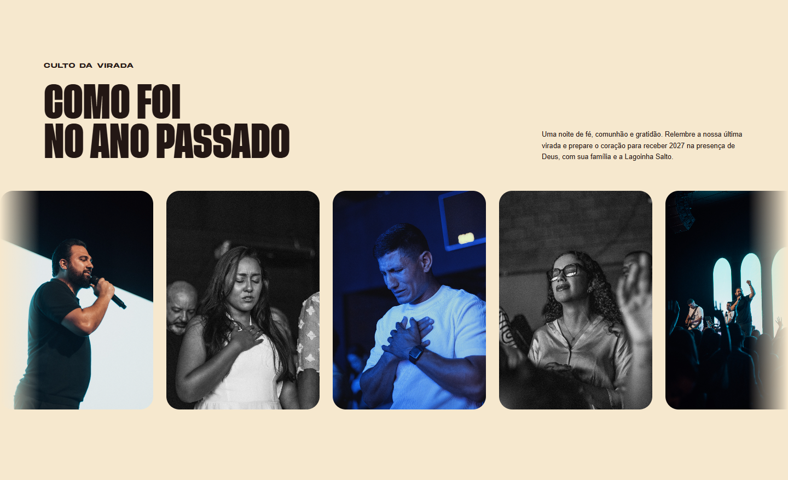
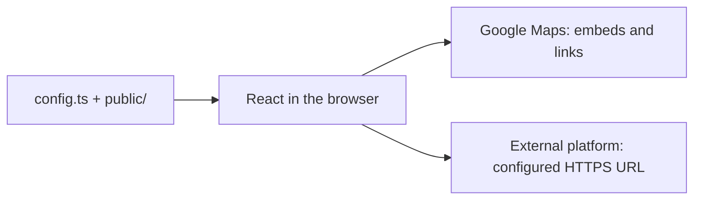

[Português (Brasil)](README.md) · [English](README.en.md)


# Vira Salto 27

Landing page for **Lagoinha Salto’s New Year’s Eve service**, welcoming 2027 with the community. It introduces the gathering, presents event information and directs ticket purchases to an external platform when a link is available.


This README covers the **Higor version**, independently of the Samuel version. This folder’s contents can become the root of a separate repository; the application does not depend on the parent workspace. The configured Git remote is [Site-Virada-2027-Lagoinha-Salto](https://github.com/higoraranda/Site-Virada-2027-Lagoinha-Salto). No production website address was confirmed.



## Contents

- [Quick start](#quick-start)
- [Overview](#overview)
- [Screenshots](#screenshots)
- [Technology](#technology)
- [Local development](#local-development)
- [Architecture and structure](#architecture-and-structure)
- [Complete use case](#complete-use-case)
- [Customization](#customization)
- [Troubleshooting](#troubleshooting)
- [Visual identity](#visual-identity)
- [Validation](#validation)
- [GitHub and deployment](#github-and-deployment)
- [Outstanding items and credits](#outstanding-items-and-credits)

## Quick start

Requirements: **Node.js 24.x** and **pnpm 11.25.0**, as specified in `package.json` and `.nvmrc`. From `site higor` in this workspace, or the root of a standalone clone of this version:

```sh
pnpm install --frozen-lockfile
pnpm dev
```

Open [http://127.0.0.1:5174/](http://127.0.0.1:5174/). No `.env.local`, database, authentication or backend is required. Without ticket configuration, controls show **Vendas em breve** (sales coming soon). Stop the server with `Ctrl+C` in the terminal that started it.

If pnpm is not installed, replace `pnpm` with `npx --yes pnpm@11.25.0`, provided npm/npx are available with your Node installation.

## Overview

| Information                        | Current implementation                                                                   |
| ---------------------------------- | ---------------------------------------------------------------------------------------- |
| Event                              | Vira Salto 27 — New Year’s Eve service                                                   |
| Organizer                          | Lagoinha Salto                                                                           |
| Date                               | December 31, 2026, welcoming 2027                                                        |
| Service start and countdown target | 10:00 PM Brasília time (UTC−03:00)                                                       |
| Locations shown                    | Lagoinha Salto in Salto, São Paulo; Restaurante Santa Rita in Itu, São Paulo, for dinner |
| Interface language                 | Brazilian Portuguese                                                                     |
| Architecture                       | Static React page with no backend or built-in checkout                                   |

### Implemented features

- Home with official artwork, a logo on the left and a ticket button on the right. The logo is the yellow V27 symbol. On desktop, the main artwork fills the width, stretching only horizontally while keeping its previous height; at up to 760px, the mobile aspect ratio and framing are preserved. The Welcome image below also fills the mobile width.
- A countdown with days, hours, minutes and seconds, replaced by a celebration message when the target is reached.
- A “VIVA O NOVO ANO” strip and a gallery containing 12 photos from the previous celebration, both scrolling continuously to the left without pause buttons.
- Two Google Maps embeds with lazy loading, descriptive titles and links opening each location in a new tab.
- Native `details`/`summary` FAQ items, footer anchor navigation, a skip-to-content link and a fixed mobile ticket call to action.
- Six ticket calls to action with centralized behavior, disabled when no valid HTTPS URL is configured.

## Screenshots

Actual screenshots of the **local production build in Chrome on November 8, 2026**, with no purchase URL configured. The main image above shows the opening at 1440 × 900; the page continues below the visible area. Animations were frozen only while capturing. These are not mockups.

### Mobile — 390 × 844



The artwork preserves the mobile framing, and ticket controls remain available at the bottom during navigation.

### Countdown



Visitors can follow the time remaining until **December 31, 2026 at 10:00 PM Brasília time**. The countdown uses the device clock.

### Memories from the previous celebration



This section contains 12 configured photos, duplicated into two groups for continuous scrolling. There are no navigation or pause controls.

### Questions and ticket availability


Visitors expand questions to read answers. The purchase answer follows the same availability state as the ticket buttons.

## Technology

| Technology                                    | Purpose                                                             |
| --------------------------------------------- | ------------------------------------------------------------------- |
| React and React DOM 19.2.0                    | Components, state and interface rendering                           |
| TypeScript 5.9.3                              | Types and static checking                                           |
| Vite 7.1.12 and React plugin 5.0.4            | Development, transformation and static builds                       |
| CSS and the FontFace API                      | Responsive layout, animations, design tokens and local font loading |
| Vitest 3.2.4                                  | Automated tests                                                     |
| Testing Library React 16.3.0 and jsdom 27.0.1 | Component rendering and interactions in tests                       |
| Playwright 1.61.1 and Axe Playwright 4.11.0   | Browser verification tools available as development dependencies    |
| Prettier 3.6.2                                | Formatting, available through `pnpm exec prettier`                  |

Installation is defined by `pnpm-lock.yaml`; `package.json` pins **pnpm 11.25.0** and **Node.js 24.x**. `pnpm-workspace.yaml` allows the esbuild installation script required by Vite.

## Local development

### Requirements and commands

Use the directory and installation instructions in the [quick start](#quick-start). Port 5174 is fixed: Vite fails if it is occupied.

| Command          | Result                                               |
| ---------------- | ---------------------------------------------------- |
| `pnpm dev`       | Local server on port 5174                            |
| `pnpm typecheck` | TypeScript checking through `tsc -b`                 |
| `pnpm test`      | Vitest test run                                      |
| `pnpm build`     | Type checking and a production build in `dist/`      |
| `pnpm preview`   | Local build preview; the terminal prints its address |

Without a global pnpm installation, replace `pnpm` with `npx --yes pnpm@11.25.0` in these commands. None of these commands deploys the application.

### Environment variable

Copy `.env.example` to `.env.local` only if you want to configure tickets locally:

| Variable          | Required | Purpose                                   |
| ----------------- | -------- | ----------------------------------------- |
| `VITE_TICKET_URL` | No       | HTTPS URL of the external ticket platform |

If the value is missing, invalid or uses a protocol other than HTTPS, every ticket button displays **“Vendas em breve”** (“Sales coming soon”) and is disabled. A valid URL enables **“Comprar ingresso”** (“Buy ticket”), opening a new tab with `noopener noreferrer`. URLs containing embedded credentials are also rejected.

Restart the server after changing the environment. `VITE_` variables are public in the build; this field is only for the purchase link. Git ignores `.env` files while keeping `.env.example` eligible for version control.

## Architecture and structure

`src/main.tsx` loads fonts and mounts `App`. Local configuration provides text, event information and media paths; React components render sections, and Vite generates static files in `dist/`. There is no application API, database, authentication, internal payment processing or worker.



Google Maps receives name/city queries without a configured API key. The ticket platform receives the visitor in a new tab; purchase and confirmation happen outside this site. The countdown is calculated locally without server requests.

```text
src/
  App.tsx             Page sections and composition
  config.ts           Event information, copy, artwork, fonts and photos
  fonts.ts            Font loading through the FontFace API
  components/         Countdown, tickets, maps, gallery and media
  lib/                Countdown calculation and URL validation
  styles.css          Layout, states and animations
  tokens.css          Colors, fonts, spacing and layout limits
public/
  fonts/              Font files and the supplied license
  media/              Artwork, logos, brand materials and photos
    jantar-ano-passado/ Gallery photos, sorted by filename
docs/screenshots/    Actual screenshots used by the READMEs
tests/               Logic and component tests
index.html           Entry point, language and metadata
vite.config.ts       Vite and Vitest configuration
vercel.json          Vercel installation and build configuration
```

| Component                         | Responsibility                                                                                               |
| --------------------------------- | ------------------------------------------------------------------------------------------------------------ |
| `TicketButton.tsx`                | Purchase action and missing-URL state                                                                        |
| `Countdown.tsx`                   | Per-second updates and the message displayed at the target                                                   |
| `Locations.tsx`                   | Two maps and their external links                                                                            |
| `NewYearStrip.tsx`                | Continuously scrolling repeated text                                                                         |
| `PastDinner`, in `RingDinner.tsx` | Continuously scrolling horizontal gallery; the filename is historical and the current version has no 3D ring |
| `Media.tsx`                       | Artwork rendering, configurable photos and image-error fallback                                              |

### BH and USA references

`MODELOS/Vira Brasil BH` and `MODELOS/Vira Brasil USA`, located in the original workspace, outside the `site higor` folder, were **structure and experience** references for the opening, section pacing, countdown and ticket calls to action. They are outside this independent folder and are not required to install or build the site. Their branding and event data do not replace Salto’s materials.

## Complete use case

**Context:** someone wants to plan their family's participation in the New Year's Eve service. **Requirement:** start the site using the quick start. **Observed state:** no purchase URL configured.

1. Open the home and check the event name and date. Visit the countdown section to see the remaining time.
2. Choose **Localização** in the footer. The site presents the church in Salto/SP and the restaurant in Itu/SP. Each card offers **Abrir no Google Maps**.
3. Choose **Dúvidas** in the footer and expand **Como faço para comprar meu ingresso?**. The answer states that sales have not started.
4. Choose **Ingressos** in the footer. Check the date, the 10:00 PM start and the disabled **Vendas em breve** control.

**Result:** the visitor finds the available information and understands purchase availability. Navigation and FAQ interactions were exercised in desktop and mobile Chrome; map URLs were inspected without validating external pin content. Evidence: [screenshots](#screenshots) and [browser report](docs/verification/readme-2026-11-08.json).

**With a valid URL:** the code and `TicketButton` tests show that all six purchase controls switch to **Comprar ingresso** and open the same HTTPS destination in a new tab. No purchase or real payment platform was exercised in this review.

## Customization

### Copy, event information and tickets

The central configuration is [`src/config.ts`](src/config.ts):

| Field                                                          | What to update                                                                        |
| -------------------------------------------------------------- | ------------------------------------------------------------------------------------- |
| `name`, `church`, `date`, `dateLabel`, `startTime`, `location` | Event identity, date, displayed start time and location                               |
| `copy`, `faq`, `navigation`                                    | Section copy, questions and footer links                                              |
| `venues`                                                       | Names, cities and map search queries                                                  |
| `ticketUrl`                                                    | Reads `VITE_TICKET_URL`; configure the environment to change the purchase destination |
| `artworks`, `fonts`                                            | Asset paths, descriptions, dimensions and font weights                                |
| `photos.venue`                                                 | Optional location photo; a text block is shown when it is absent                      |

Title, description and Open Graph metadata are in [`index.html`](index.html). Review these and the corresponding copy whenever the event’s name, date or message changes.

### Countdown

The implemented and confirmed target is **December 31, 2026, at 10:00 PM Brasília time**:

```ts
countdownTarget: "2026-12-31T22:00:00-03:00";
```

The calculation uses this absolute instant regardless of the visitor’s time zone. It reaches zero at the target and does not automatically advance to another year. The current time comes from the device’s clock, without server synchronization.

For a future change, review `countdownTarget`, `startTime`, `copy.countdownNote`, the corresponding FAQ answer and `tests/event.test.tsx`, which currently fixes 10:00 PM. This documentation update did not change the time.

### Photos, artwork and fonts

- **Gallery:** add files to `public/media/jantar-ano-passado/`. They are discovered automatically at build time and sorted by filename using numeric comparison. Supported formats are `jpg`, `jpeg`, `png`, `webp` and `avif`; uppercase `JPG`, `JPEG` and `PNG` are also accepted. The folder name has been retained, but the section presents memories of the New Year’s Eve service.
- **Descriptions and framing:** edit the `dinnerPhotos` mapping in `src/config.ts` to customize `alt`, `fit` and `position`. The current default is `cover`; card dimensions and aspect ratio are defined by `.memory-card` in `src/styles.css`.
- **Artwork:** the home uses `public/media/home_image.png`; Welcome uses `public/media/foto_abaixo_home.png`; the page logo uses `public/media/01_LOGOS/PNG/02_simbolo-v27_amarelo.png`. When replacing a file, update its path, description and dimensions in `artworks`.
- **Fonts:** the files in use are `MonumentExtended-Regular.otf` (400) and `TuskerGrotesk-5700Bold.otf` (700), in `public/fonts/`. Configure them in `fonts`; `src/fonts.ts` applies the families after loading and keeps a system fallback if loading fails.

New photos and production environment changes require a new build/deployment to appear on the published site.

## Troubleshooting

| Symptom                                          | What to check                                                                                                                                                          |
| ------------------------------------------------ | ---------------------------------------------------------------------------------------------------------------------------------------------------------------------- |
| Port 5174 is occupied                            | Stop your previous instance with `Ctrl+C`; `--strictPort` prevents silently selecting another port.                                                                    |
| Button shows “Vendas em breve”                   | Check `VITE_TICKET_URL`: HTTPS without embedded credentials is required. Restart Vite or rebuild after changing the environment.                                       |
| Missing artwork or photo                         | Check paths, extensions and letter case. URLs start at `/media/`, without `/public/`.                                                                                  |
| Different font                                   | Check `public/fonts/`; Neue Haas depends on a local installation while `fonts.body` is `null`.                                                                         |
| Maps unavailable                                 | Embeds depend on connectivity and Google; each card also provides an external link.                                                                                    |
| Config loading fails in a restricted environment | This review used Vite's runner: `pnpm exec vite build --configLoader runner`; run `pnpm typecheck` first. For tests, use `pnpm exec vitest run --configLoader runner`. |

## Visual identity

The artwork, logos, fonts and palette are the materials supplied for **Vira Salto**. The BH and USA versions informed the structure and experience, not this page’s branding. The logos displayed in this README are existing official files and have not been redesigned.

| Color  | Token      | Value     |
| ------ | ---------- | --------- |
| Cream  | `--cream`  | `#F6E8CE` |
| Blue   | `--blue`   | `#1E90FC` |
| Yellow | `--yellow` | `#F8E520` |
| Dark   | `--ink`    | `#231714` |

The palette’s source of truth is [`src/tokens.css`](src/tokens.css). Layout and animations are in [`src/styles.css`](src/styles.css), and section structure is in `src/App.tsx`. Ticket buttons use the palette’s yellow.

## Validation

Checks run on **November 8, 2026**, using Node.js **24.22.1** and existing installed dependencies. npm/pnpm were not on this session's PATH, and the default config loader encountered sandbox access restrictions, so local executables were invoked directly:

| Command or check                                                 | Result                                                                                                    |
| ---------------------------------------------------------------- | --------------------------------------------------------------------------------------------------------- |
| `node node_modules/typescript/bin/tsc -b`                        | Passed                                                                                                    |
| `node node_modules/vite/bin/vite.js build --configLoader runner` | Static build completed in `dist/`                                                                         |
| `node node_modules/vitest/vitest.mjs run --configLoader runner`  | 22 passing tests across 2 files                                                                           |
| Chrome, local build                                              | Home, locations, FAQ and tickets at 1440 × 900 and 390 × 844; no JavaScript errors or horizontal overflow |

A clean dependency installation was not repeated: installation instructions match the manifest, lockfile and existing configuration. The [browser report](docs/verification/readme-2026-11-08.json) records the observed workflow and scenarios.

Tests cover countdown calculation and lifecycle, URL validation, purchase state, section order, absence of pause controls and image-error fallback. Browser checks confirmed loaded fonts and artwork, six disabled calls to action, 12 configured photos and two embedded maps; they do not certify Google Maps’ external availability.

Reduced-motion preferences disable several animations, but the photo strip retains an `animation: ... !important` rule; reduced motion is not fully applied to that gallery. This limitation was identified without changing application behavior.

This folder has no `test:browser`, `lint` or `format` script and no CI pipeline. Playwright and Axe are installed as tools; this does not amount to a full accessibility audit or testing across every browser. Historical reports in the parent directory describe earlier stages, including carousel designs that have since been replaced.

## GitHub and deployment

### Repository

The local Git repository has `origin` configured as [higoraranda/Site-Virada-2027-Lagoinha-Salto](https://github.com/higoraranda/Site-Virada-2027-Lagoinha-Salto). This confirms local configuration without asserting repository visibility or remote state.

This folder is an independent application; use its contents as the root of a dedicated repository. `site samuel` and the parent-folder application are separate versions, not dependencies of the Higor version. The BH/USA references are also unnecessary at runtime.

Include the READMEs, `docs/screenshots/`, `docs/verification/`, source, `public/`, tests and configuration. `.gitignore` excludes dependencies, builds, caches, local test reports, `.env` files and Vercel state. No commit, push or deployment was performed in this review.

### Vercel

The verifiable configuration is in [`vercel.json`](vercel.json):

| Setting          | Value                                              |
| ---------------- | -------------------------------------------------- |
| Framework        | Vite                                               |
| Install Command  | `npx --yes pnpm@11.25.0 install --frozen-lockfile` |
| Build Command    | `npx --yes pnpm@11.25.0 run build`                 |
| Output Directory | `dist`                                             |
| Node.js          | `24.x`, as specified in `package.json`             |

After importing a repository containing only this version, set **Root Directory to `./`**. If you keep the entire workspace in the repository, the application directory is `site higor` instead. Set `VITE_TICKET_URL` in the desired environments when the official URL is available, and redeploy after changing it. The page uses anchors and requires neither a backend nor server routes.

These values were checked against local files without deploying or consulting the Vercel dashboard. No production URL was confirmed.

## Outstanding items and credits

- **Tickets:** `VITE_TICKET_URL` is empty in the example; purchases remain unavailable in the captured preview. Prices and conditions are not configured.
- **Video:** the Welcome area still uses a static image; no video player is implemented.
- **Publication:** a local Git repository and configured remote exist; no production website address was confirmed in this review.
- **Licensing:** no general code license was found. The [Monument agreement](public/fonts/Monument-Personal-license-agreement.txt) limits the supplied weights to personal use and restricts redistribution. The [brand kit’s font instructions](public/media/05_FONTES/LEIA-ME_FONTES.txt) also require licenses for commercial fonts. Confirm publication and distribution rights for fonts and materials before uploading a public repository or publishing the site. No MIT license or additional authorization has been added.

Event organizer: **Lagoinha Salto**. Visual materials: the supplied **Vira Salto** identity. Type credits identified in the files: **Pangram Pangram** (Monument Extended) and **Lewis McGuffie Type** (Tusker Grotesk).
