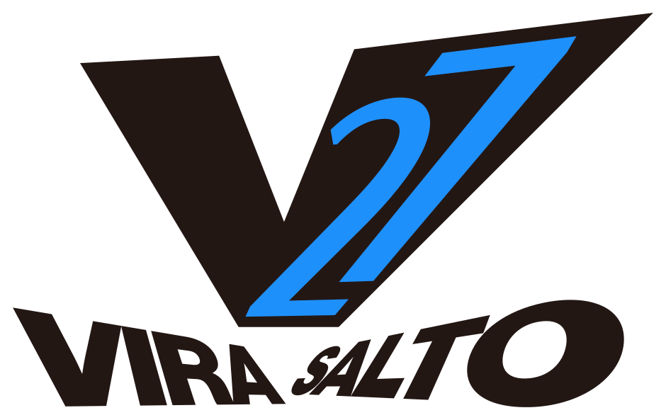
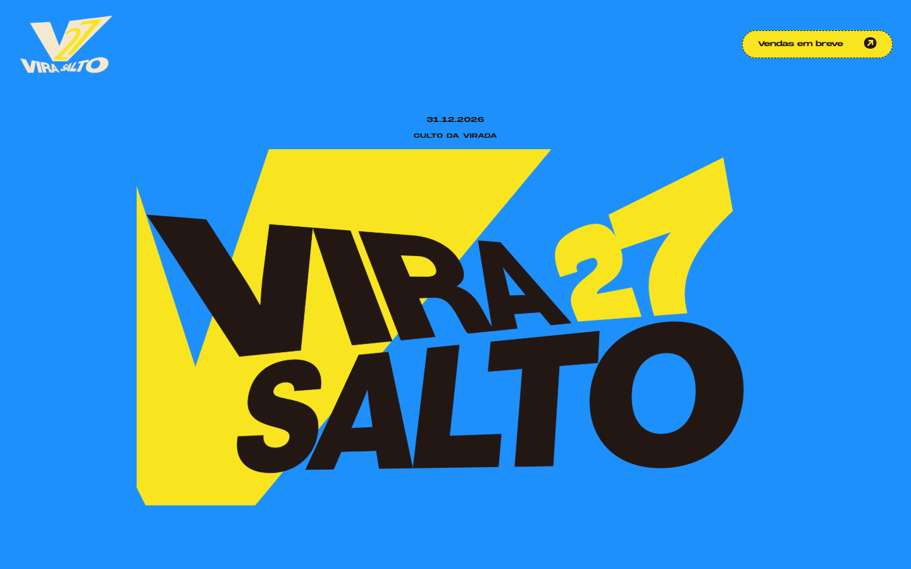

[Português (Brasil)](README.md) · [English](README.en.md)

<picture>
  <source media="(prefers-color-scheme: dark)" srcset="public/media/01_LOGOS/SVG/01_principal_v27-vira-salto_negativo-amarelo.svg">
  
</picture>

# Vira Salto 27

Landing page do **Culto da Virada da Lagoinha Salto**, para receber 2027 com a comunidade. Apresenta o encontro, reúne informações e encaminha a compra para uma plataforma externa quando o link estiver disponível.


Este README documenta a **versão Higor**, independente da versão Samuel. O conteúdo desta pasta pode ser a raiz de um repositório próprio; a aplicação não depende da pasta superior do workspace. Não há endereço público de site nem remoto Git confirmados nesta cópia.

## Visão geral

| Informação                         | Implementação atual                                                           |
| ---------------------------------- | ----------------------------------------------------------------------------- |
| Evento                             | Vira Salto 27 — Culto da Virada                                               |
| Organização                        | Lagoinha Salto                                                                |
| Data                               | 31 de dezembro de 2026, recebendo 2027                                        |
| Início do culto e alvo da contagem | 22h, horário de Brasília (UTC−03:00)                                          |
| Locais apresentados                | Lagoinha Salto, em Salto/SP; Restaurante Santa Rita, em Itu/SP, para o jantar |
| Idioma da interface                | Português brasileiro                                                          |
| Arquitetura                        | Página estática em React, sem backend ou checkout próprio                     |

### O que está implementado

- Home com artes oficiais, logo à esquerda e botão de ingressos à direita. A arte principal ocupa 70% da largura no desktop; no celular, ela e a imagem Welcome abaixo ocupam 100%.
- Contagem regressiva com dias, horas, minutos e segundos; ao chegar ao alvo, mostra uma mensagem de celebração.
- Faixa “VIVA O NOVO ANO” e galeria com 12 fotos da última virada, ambas deslizando continuamente para a esquerda, sem botões de pausa.
- Dois mapas do Google com carregamento adiado, títulos descritivos e links para abrir as localizações em outra aba.
- Perguntas frequentes com `details`/`summary`, navegação por âncoras no rodapé, link para pular ao conteúdo e chamada de ingressos fixa no celular.
- Seis pontos de chamada para ingressos, com comportamento centralizado e estado desativado quando falta uma URL HTTPS válida.

## Demonstração

Capturas reais do build local em Chrome, em **22/10/2026**, sem mockups, retoques ou alterações nas imagens. Os ingressos aparecem no estado sem URL de compra.

**Desktop — 1440 × 900**



<details>
<summary>Celular — 390 × 844</summary>

<p></p>

</details>

## Tecnologias

| Tecnologia                                  | Uso                                                                                      |
| ------------------------------------------- | ---------------------------------------------------------------------------------------- |
| React e React DOM 19.2.0                    | Componentes, estado e montagem da interface                                              |
| TypeScript 5.9.3                            | Tipagem e verificação estática                                                           |
| Vite 7.1.12 e plugin React 5.0.4            | Desenvolvimento, transformação e build estático                                          |
| CSS e FontFace API                          | Layout responsivo, animações, tokens e carregamento das fontes locais                    |
| Vitest 3.2.4                                | Testes automatizados                                                                     |
| Testing Library React 16.3.0 e jsdom 27.0.1 | Renderização e interação nos testes de componentes                                       |
| Playwright 1.61.1 e Axe Playwright 4.11.0   | Ferramentas de verificação de navegador disponíveis como dependências de desenvolvimento |
| Prettier 3.6.2                              | Formatação, disponível via `pnpm exec prettier`                                          |

A instalação é definida por `pnpm-lock.yaml`; `package.json` fixa **pnpm 11.25.0** e **Node.js 24.x**. `pnpm-workspace.yaml` autoriza o script de instalação do esbuild usado pelo Vite.

## Execução local

### Pré-requisitos

- Node.js **24.x**, também indicado em `.nvmrc`.
- pnpm **11.25.0**, ou npm/npx de uma instalação padrão do Node para executar os comandos abaixo.

Execute na pasta que contém `package.json` — `site higor` neste workspace:

```sh
npx --yes pnpm@11.25.0 install --frozen-lockfile
npx --yes pnpm@11.25.0 dev
```

O desenvolvimento abre em [http://127.0.0.1:5174/](http://127.0.0.1:5174/). A porta é fixa: pare a instância anterior se ela já estiver ocupada.

Com pnpm disponível, os scripts são:

| Comando          | Resultado                                             |
| ---------------- | ----------------------------------------------------- |
| `pnpm dev`       | Servidor local na porta 5174                          |
| `pnpm typecheck` | Verificação TypeScript com `tsc -b`                   |
| `pnpm test`      | Execução dos testes com Vitest                        |
| `pnpm build`     | Verificação de tipos e geração do build em `dist/`    |
| `pnpm preview`   | Prévia local do build; endereço informado no terminal |

Sem pnpm global, substitua `pnpm` por `npx --yes pnpm@11.25.0` nesses comandos. Nenhum deles publica a aplicação.

### Variável de ambiente

Copie `.env.example` para `.env.local` somente se quiser configurar ingressos localmente:

| Variável          | Obrigatória | Uso                                          |
| ----------------- | ----------- | -------------------------------------------- |
| `VITE_TICKET_URL` | Não         | URL HTTPS da plataforma externa de ingressos |

Sem valor, com URL inválida ou com protocolo diferente de HTTPS, todos os botões exibem **“Vendas em breve”** e ficam desativados. Uma URL válida ativa **“Comprar ingresso”**, em nova aba, com `noopener noreferrer`. URLs com credenciais embutidas também são rejeitadas.

Reinicie o servidor após editar o ambiente. Variáveis `VITE_` ficam públicas no build; este campo recebe somente o link de compra. Arquivos `.env` são ignorados pelo Git; `.env.example` permanece versionável.

## Estrutura do projeto

```text
src/
  App.tsx             Seções e composição da página
  config.ts           Informações, textos, artes, fontes e fotos
  fonts.ts            Carregamento das fontes pela FontFace API
  components/         Contador, ingressos, mapas, galeria e mídia
  lib/                Cálculo da contagem e validação da URL
  styles.css          Layout, estados e animações
  tokens.css          Cores, fontes, espaçamento e limites
public/
  fonts/              Arquivos de fontes e licença fornecida
  media/              Artes, logotipos, materiais da marca e fotos
    jantar-ano-passado/ Fotos da galeria, em ordem de nome
docs/screenshots/    Capturas reais usadas nos READMEs
tests/               Testes de lógica e componentes
index.html           Entrada, idioma e metadados
vite.config.ts       Configuração do Vite e do Vitest
vercel.json          Configuração de instalação e build na Vercel
```

| Componente                        | Responsabilidade                                                                        |
| --------------------------------- | --------------------------------------------------------------------------------------- |
| `TicketButton.tsx`                | Ação de compra e estado sem URL                                                         |
| `Countdown.tsx`                   | Atualização por segundo e mensagem ao chegar ao alvo                                    |
| `Locations.tsx`                   | Dois mapas e seus links externos                                                        |
| `NewYearStrip.tsx`                | Faixa contínua com texto repetido                                                       |
| `PastDinner`, em `RingDinner.tsx` | Galeria horizontal contínua; o nome do arquivo é histórico, sem anel 3D na versão atual |
| `Media.tsx`                       | Artes proporcionais, fotos configuráveis e fallback de falha                            |

### Referências BH e USA

`MODELOS/Vira Brasil BH` e `MODELOS/Vira Brasil USA`, presentes no workspace original, fora da pasta `site higor`, foram referências de **estrutura e experiência**: abertura, ritmo das seções, contagem e chamadas de ingresso. Não fazem parte desta pasta independente e não são necessários para instalar ou compilar o site. Sua identidade visual e seus dados de evento não substituem os materiais de Salto.

## Personalização

### Textos, evento e ingressos

A configuração central fica em [`src/config.ts`](src/config.ts):

| Campo                                                          | O que editar                                                               |
| -------------------------------------------------------------- | -------------------------------------------------------------------------- |
| `name`, `church`, `date`, `dateLabel`, `startTime`, `location` | Identificação, data, horário exibido e local                               |
| `copy`, `faq`, `navigation`                                    | Textos das seções, perguntas e links do rodapé                             |
| `venues`                                                       | Nomes, cidades e consultas usadas nos mapas                                |
| `ticketUrl`                                                    | Lê `VITE_TICKET_URL`; configure o ambiente para trocar o destino de compra |
| `artworks`, `fonts`                                            | Caminhos, descrições, dimensões e pesos das artes/fontes                   |
| `photos.venue`                                                 | Foto opcional do local; ausente, aparece um bloco textual                  |

Metadados de título, descrição e Open Graph ficam em [`index.html`](index.html). Se alterar nome, data ou mensagem do evento, revise também esses metadados e os textos correspondentes.

### Contagem regressiva

O alvo implementado e confirmado é **31/12/2026 às 22h, horário de Brasília**:

```ts
countdownTarget: "2026-12-31T22:00:00-03:00";
```

O cálculo usa esse instante absoluto, independentemente do fuso do visitante, e zera ao chegar ao alvo, sem avançar automaticamente para outro ano. A hora atual vem do relógio do dispositivo, sem sincronização com servidor.

Para uma alteração futura, revise `countdownTarget`, `startTime`, `copy.countdownNote`, a resposta correspondente no FAQ e `tests/event.test.tsx`, que atualmente fixa 22h. O horário não foi alterado nesta revisão documental.

### Fotos, artes e fontes

- **Galeria:** adicione arquivos em `public/media/jantar-ano-passado/`. Eles são descobertos automaticamente no build, ordenados por nome com comparação numérica. Formatos: `jpg`, `jpeg`, `png`, `webp` e `avif`; também são aceitos `JPG`, `JPEG` e `PNG`. O nome da pasta foi preservado, mas a seção apresenta recordações do Culto da Virada.
- **Descrições e enquadramento:** ajuste o mapeamento `dinnerPhotos` em `src/config.ts` para personalizar `alt`, `fit` e `position`. O padrão atual é `cover`; tamanho e proporção dos cartões ficam em `.memory-card`, em `src/styles.css`.
- **Artes:** a home usa `public/media/home_image.png`; Welcome, `public/media/foto_abaixo_home.png`; o logo da página, `public/media/logo_lagoinha_salto_virada.png`. Ao trocar um arquivo, atualize o caminho, a descrição e as dimensões em `artworks`.
- **Fontes:** os textos em CAPS preservam `MonumentExtended-Regular.otf` (400) e `TuskerGrotesk-5700Bold.otf` (700), em `public/fonts/`. O corpo usa Neue Haas Grotesk Display Pro ou Text Pro quando instalada, com Arial como alternativa. O arquivo da Neue Haas ainda não acompanha o projeto: para servi-la a todos os visitantes, adicione o arquivo em `public/fonts/` e configure `fonts.body` com `{ src: "/fonts/nome-do-arquivo.woff2", weight: "400" }` (ou o intervalo de pesos de uma fonte variável). `src/fonts.ts` aplica as famílias após o carregamento. Os tokens de tipografia ficam em `src/tokens.css`; `.eyebrow` e `.hero-event-date` usam `--font-display` para manter a fonte anterior dos rótulos em CAPS.

Novas fotos ou mudanças no ambiente de produção precisam de novo build/deploy para aparecer no site publicado.

## Identidade visual

As artes, logotipos, fontes e a paleta são os materiais fornecidos para **Vira Salto**. As versões BH e USA orientam a estrutura e a experiência, sem definir a marca desta página. Os logotipos exibidos neste README são arquivos oficiais existentes, sem redesenho.

| Cor     | Token      | Valor     |
| ------- | ---------- | --------- |
| Creme   | `--cream`  | `#F6E8CE` |
| Azul    | `--blue`   | `#1E90FC` |
| Amarelo | `--yellow` | `#F8E520` |
| Escuro  | `--ink`    | `#231714` |

A fonte de verdade da paleta é [`src/tokens.css`](src/tokens.css). Layout e animações ficam em [`src/styles.css`](src/styles.css); a estrutura das seções, em `src/App.tsx`. Os botões de ingressos usam o amarelo da paleta.

## Validação

Verificações executadas nesta revisão, em **22/10/2026**, sobre o código existente:

| Verificação               | Resultado                                                                                           |
| ------------------------- | --------------------------------------------------------------------------------------------------- |
| `pnpm test`               | 22 testes aprovados em 2 arquivos                                                                   |
| `pnpm typecheck`          | Aprovado                                                                                            |
| `pnpm build`              | Build estático concluído                                                                            |
| Chrome, desktop e celular | Capturas reais em 1440 × 900 e 390 × 844; sem erro JavaScript ou rolagem horizontal nesses cenários |

Os testes cobrem cálculo e ciclo de vida do contador, validação da URL, estado de compra, ordem de seções, ausência de controles de pausa e fallback de imagem. As verificações de navegador confirmaram fontes e artes carregadas, seis chamadas desativadas, 12 fotos cadastradas e dois mapas embutidos; não certificam a disponibilidade externa do Google Maps.

Não há script `test:browser`, `lint`, `format` ou pipeline de CI nesta pasta. Playwright e Axe estão instalados como ferramentas, mas isso não equivale a uma auditoria completa de acessibilidade ou a testes em todos os navegadores. Relatórios antigos da pasta superior descrevem etapas anteriores, inclusive formatos de carrossel já substituídos.

## GitHub e publicação

### Versionar somente esta versão

Crie o repositório usando **o conteúdo de `site higor` como raiz**, sem incluir a pasta superior ou a versão Samuel. Antes de publicar as fontes e os materiais, confira as pendências de licença abaixo.

Comandos para você executar, dentro desta pasta, quando estiver pronto:

```sh
git init -b main
git add .
git status --short
git commit -m "Adiciona site Vira Salto 27"
```

Depois associe o endereço real do seu repositório e envie a branch, pelo GitHub Desktop ou pelo terminal:

```sh
git remote add origin URL_DO_SEU_REPOSITORIO
git push -u origin main
```

Substitua `URL_DO_SEU_REPOSITORIO` pelo remoto que você criar. Inclua os dois READMEs e `docs/screenshots/`, além de código, arquivos de `public/`, testes, lockfile e configurações. O `.gitignore` exclui dependências, build, caches, relatórios locais, `.env` e estado da Vercel. Nesta revisão não foi criado repositório, commit, push ou deploy.

### Vercel

A configuração verificável está em [`vercel.json`](vercel.json):

| Configuração     | Valor                                              |
| ---------------- | -------------------------------------------------- |
| Framework        | Vite                                               |
| Install Command  | `npx --yes pnpm@11.25.0 install --frozen-lockfile` |
| Build Command    | `npx --yes pnpm@11.25.0 run build`                 |
| Output Directory | `dist`                                             |
| Node.js          | `24.x`, conforme `package.json`                    |

Após importar o repositório contendo apenas esta versão, use **Root Directory: `./`**. Se mantiver o workspace inteiro no repositório, o diretório da aplicação passa a ser `site higor`. Configure `VITE_TICKET_URL` nos ambientes desejados quando tiver a URL oficial e faça novo deploy após alterar esse valor. A página usa âncoras, sem necessidade de backend ou rotas de servidor.

Referências: [Vite na Vercel](https://vercel.com/docs/frameworks/frontend/vite) e [gerenciadores de pacotes da Vercel](https://vercel.com/docs/package-managers). Nenhuma URL de produção foi confirmada.

## Pendências e créditos

- **Ingressos:** `VITE_TICKET_URL` está vazio no exemplo; a compra permanece indisponível na prévia capturada. Valores e condições não estão cadastrados.
- **Vídeo:** a área Welcome continua usando uma imagem estática; não existe player implementado.
- **Publicação:** não há metadados de repositório Git, remoto ou URL pública confirmados nesta cópia.
- **Licenças:** não foi encontrada licença geral do código. O [acordo da Monument](public/fonts/Monument-Personal-license-agreement.txt) limita os pesos fornecidos a uso pessoal e restringe redistribuição. As [orientações do kit](public/media/05_FONTES/LEIA-ME_FONTES.txt) também exigem licenciamento das fontes comerciais. Confirme os direitos de publicação e distribuição das fontes e materiais antes de subir um repositório público ou publicar o site. Nenhuma licença MIT ou autorização adicional foi adicionada.

Organização do evento: **Lagoinha Salto**. Materiais visuais: identidade fornecida para **Vira Salto**. Créditos tipográficos identificados nos arquivos: **Pangram Pangram** (Monument Extended) e **Lewis McGuffie Type** (Tusker Grotesk).
